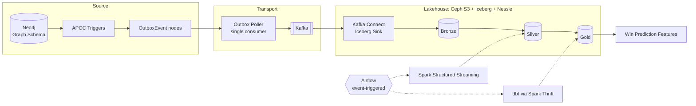
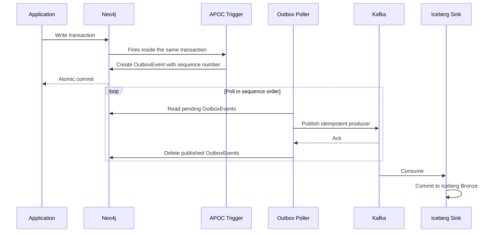
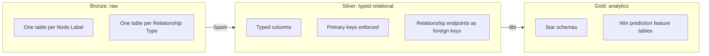

# Tournament Data Analytics

A sport-agnostic, end-to-end data engineering pipeline. Tournament data is modelled in a Neo4j graph, captured as change events, streamed through Kafka into Apache Iceberg tables, and transformed into analytics-ready datasets using a Medallion Architecture (Apache Spark + dbt).

## Table of Contents

- [Overview](#overview)
- [Architecture](#architecture)
- [Graph Schema](#graph-schema)
- [Change Data Capture](#change-data-capture)
- [Lakehouse Storage](#lakehouse-storage)
- [Medallion Architecture](#medallion-architecture)
- [Orchestration and CI/CD](#orchestration-and-cicd)
- [Tech Stack](#tech-stack)
- [Current Scope and Limitations](#current-scope-and-limitations)

## Overview

| Aspect | Detail |
|---|---|
| Source of truth | Neo4j (graph schema) |
| Change capture | APOC triggers with a transactional outbox |
| Transport | Kafka |
| Ingestion | Kafka Connect Iceberg Sink |
| Storage | Apache Iceberg on Ceph (S3-compatible), Nessie catalog |
| Transformation | Apache Spark (Bronze, Silver) and dbt (Gold) |
| Orchestration | Apache Airflow (event-triggered) |
| Delivery | Docker, GitHub Actions |
| Sports modelled | Basketball, Track & Field |
| Formats modelled | Knockout, Round-robin |
| Gold output | Win prediction features |

## Architecture



## Graph Schema

Tournaments are naturally hierarchical, which maps directly onto a graph:

```
User -> Organization -> Tournament -> Discipline -> Event -> Round
```


<!-- TODO: add the graph schema image at docs/images/graph-schema.png -->

### Design decisions

**Why a graph.** Queries that relate high-level and low-level entities (for example, organization to round) are simple traversals in a graph. A relational model would need a chain of joins across every level of the hierarchy.

**Sport-agnostic modelling.** Any sport is described by two attributes: the **number of players** and the **format**. A new sport is added by configuration rather than by changing the schema. Tournament formats (knockout, round-robin) are defined and handled individually.

## Change Data Capture

Neo4j has no log-based CDC like a relational WAL, so changes are captured with **APOC triggers** writing to a **transactional outbox**.



### Ordering

Timestamps alone are unreliable under concurrency: two transactions can commit in the same millisecond, and a transaction that started earlier can commit after a faster one. Ordering therefore relies on a **monotonic sequence counter**:

1. A monotonic sequence counter is maintained in the graph.
2. It is incremented **inside the write transaction**, so the sequence number commits atomically with the data change.
3. A **single consumer** polls the outbox, preserving sequence order.

### Delivery semantics

Exactly-once delivery over a network is not achievable, because acknowledgments can be lost. The pipeline instead provides **at-least-once delivery with idempotent consumers**, yielding effectively-once processing:

1. **Atomic commit:** the data change and its `OutboxEvent` are written in one transaction.
2. **Acknowledge before deleting:** outbox nodes are removed only after Kafka acknowledges them. If the poller crashes between publishing and deleting, it re-publishes on restart, which is safe because consumers are idempotent.
3. **Idempotent producer:** `enable.idempotence=true` prevents duplicates from retries within a producer session.

## Lakehouse Storage

| Component | Choice |
|---|---|
| Table format | Apache Iceberg |
| Object storage | Ceph (S3-compatible) |
| Catalog | Project Nessie |
| Write mode | Merge-on-Read, favouring low-latency writes for near-real-time analytics such as win prediction |
| Ingestion | Kafka Connect Iceberg Sink |

### Partitioning and small-file strategy

Over-partitioning is the fastest way to create small files, since every parallel writer task opens at least one new file per partition on every commit. To control this:

- **Decouple Kafka partitions from Iceberg partitions.**
- **Target 1 GB+ of data per Iceberg partition.**
- **Use hidden partitioning** so consumers do not depend on the physical layout.
- **Route records by Iceberg partition before writing**, so each writer task targets few partitions.

## Medallion Architecture



| Layer | Contents | Engine |
|---|---|---|
| **Bronze** | Separate entity and edge tables: one per node label and one per relationship type. Properties are stored as a raw JSON/MAP column alongside system IDs. | Spark |
| **Silver** | Typed relational tables. JSON property maps are unpacked into strongly-typed columns, primary keys are enforced, and relationship endpoints become explicit foreign keys. | Spark |
| **Gold** | Flattened star schemas and feature tables, built by joining Silver node and relationship tables along specific traversal paths or aggregating multi-hop metrics. | dbt |

### Responsibility split

- **Spark** handles heavy data engineering and ingestion (Bronze and Silver).
- **dbt** handles SQL-based business modelling and governance (Gold), running on Iceberg tables through the `dbt-spark` adapter against the **Spark Thrift Server**.

### Incremental processing

Gold models use dbt incremental materialization:

- `is_incremental()` filter combined with a `unique_key`.
- A **lookback window** to absorb late-arriving data.
- Targeted range or **microbatch** backfills.

## Orchestration and CI/CD

- **Apache Airflow** orchestrates the Bronze-to-Silver-to-Gold flow. The pipeline is **streaming and event-triggered** rather than schedule-driven.
- **Docker** is used to package the services.
- **GitHub Actions** runs CI/CD.

## Tech Stack

| Category | Technology |
|---|---|
| Graph database | Neo4j, APOC |
| Messaging | Apache Kafka, Kafka Connect |
| Table format | Apache Iceberg |
| Catalog | Project Nessie |
| Object storage | Ceph (S3-compatible) |
| Processing | Apache Spark, Spark Thrift Server |
| Transformation | dbt (`dbt-spark`) |
| Orchestration | Apache Airflow |
| Delivery | Docker, GitHub Actions |

## Current Scope and Limitations

- **Sports:** Basketball and Track & Field.
- **Formats:** Knockout and round-robin.
- **Captured changes:** create and update events only. Deletes and relationship removals are not captured yet.
- **Gold output:** win prediction features.


# Getting Started

## Requirements
1. Python >= 3.12
2. uv
3. Docker

## Activate virtual environment
```bash
uv venv --python 3.12.12
# for Linux/macOS:
source .venv/bin/activate
# for Windows
.venv\Script\activate
```

## Install Dependencies
```bash
uv sync
```

# Run the Application

## Run Docker compose
```bash
docker compose up -d
```
